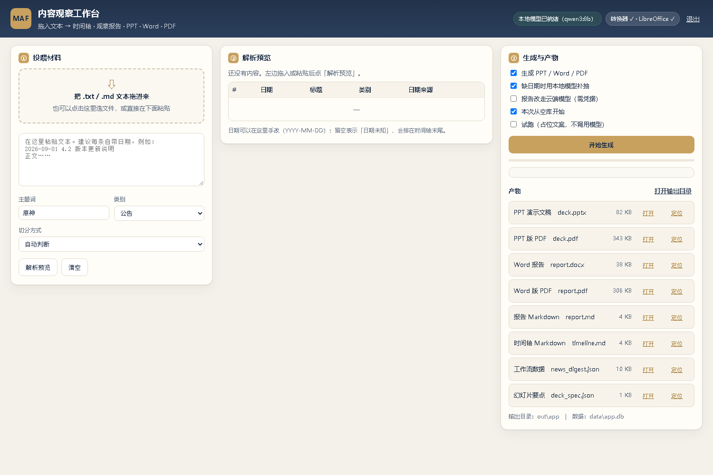
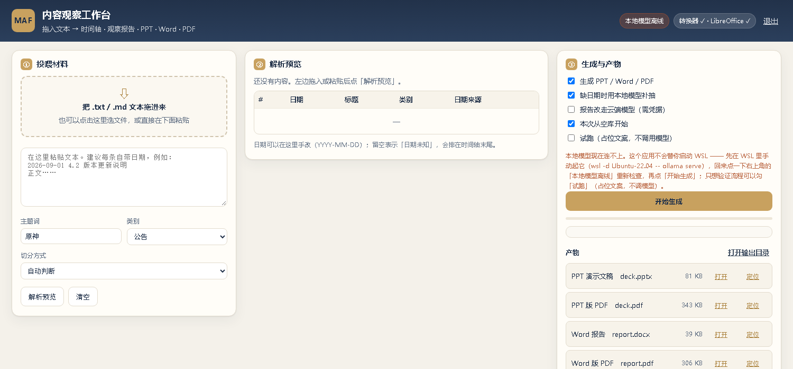
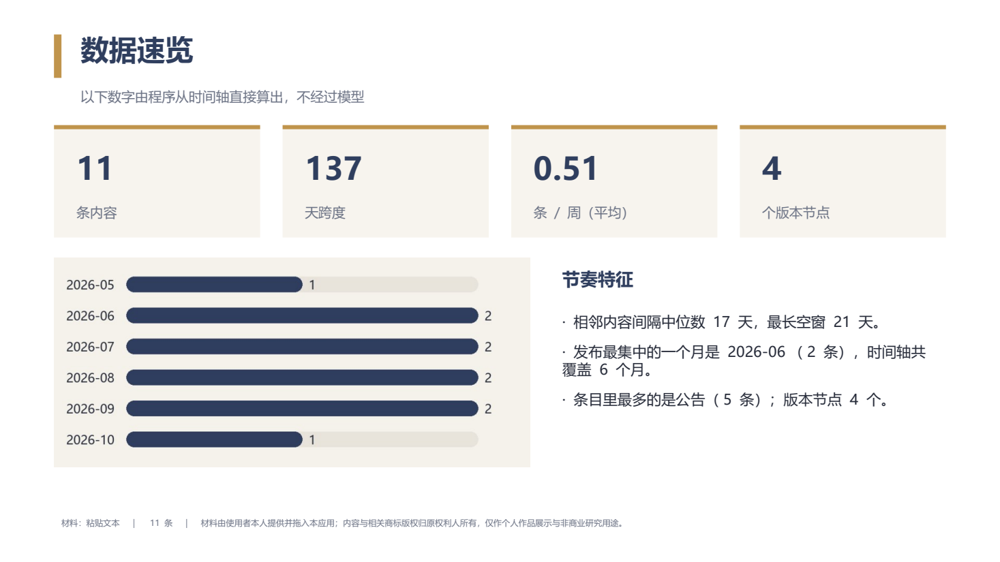
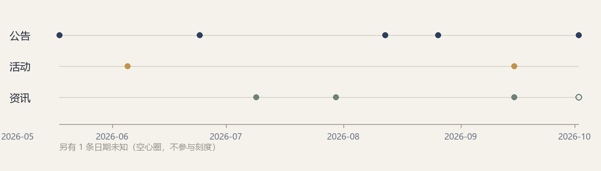

# MAF 内容观察工作台：人工投喂 → 时间轴 / 观察报告 / PPT / Word / PDF

把一堆文本材料变成一份能交付的东西：**顺序入库** → **本地大模型逐条概括** → **时间轴与观察报告** →
**PPT / Word / PDF**。整个应用唯一的数据来源是使用者自己拖进去或粘贴进去的文本 ——
**不访问任何网络接口、不抓取任何站点、不使用任何游戏客户端文件**。



## 快速开始

三条入口，按需要挑一条：

| 想干什么 | 怎么跑 |
|---|---|
| 打开界面，拖文本进去、看着进度、直接拿产物 | 双击 `run_app.bat`（或 `myvenv\Scripts\python.exe pipeline.py app`） |
| 一条命令跑完全程 | `run_all.bat -Materials 材料.txt` |
| 分步来（投喂 / 出行 / 渲染各一次） | `pipeline.py ingest` → `pipeline.py news-report --deck` → `render_office.py` |

```powershell
# 1) 本地模型由你自己在 WSL 里起（应用不会替你启动 WSL，也不留常驻进程）
wsl -d Ubuntu-22.04 -- ollama serve        # 或者：wsl -d Ubuntu-22.04 -- sudo systemctl start ollama

# 2) 全自动：投喂 + 工作流 + PPT/Word/PDF
run_all.bat -Materials samples\示例材料.txt

# 3) 只要界面
run_app.bat
```

`run_all.ps1` 的参数：`-Materials`（可多个 txt/md）、`-Mode`（切分方式）、`-Subject`（主题词）、
`-Cloud`（**全程走云端**，不碰本地模型）、`-SkipIngest` / `-SkipPdf`。
不加 `-Cloud` 时它只**检查**本地模型在不在，探不到就把上面那行 WSL 命令打出来然后停下 ——
它不会替你启动 WSL。

## 界面怎么用

三栏，从左到右就是一条流水线：

1. **投喂材料** —— 把 `.txt` / `.md` 拖进虚线框，或直接在下面粘贴（推荐每条自带日期前缀，
   例如 `2026-09-01 4.2 版本更新说明` 换行再写正文）。主题词、默认类别、切分方式也可以在这里定。
2. **解析预览** —— 点「解析预览」后逐条列出来：日期、标题、类别、日期来源。
   **日期和类别都能在表格里直接改**（日期留空＝「日期未知」；类别决定它落在时间轴的哪条泳道）。
3. **生成与产物** —— 勾选项：生成 PPT/Word/PDF、缺日期时用本地模型补抽、报告走云端、
   本次从空库开始、试跑（用占位文案，不调模型）。点「开始生成」后进度和日志逐行刷出来，
   结束后产物区列出文件，可以「打开」或「定位」。

界面是个本地网页：`app/server.py` 用标准库 `http.server` 只绑 `127.0.0.1` 的随机端口，
`app/ui/` 是它的静态文件，窗口由 pywebview 提供（装不上时自动退回 Edge 的 `--app` 窗口）。
长任务（模型调用 + 渲染 + 转 PDF）跑在后台线程里，前端拿 `job_id` 轮询进度，关掉页面也不影响任务。
## 它到底做了什么

```
   拖入 / 粘贴的文本
        │  ingest.py      确定性切条：日期前缀 → 标题行 → 空行 → 整篇
        │                 （认不出日期的条目才交给本地模型补抽）
        ▼
   SQLite（store.py）    按发布时间升序存储；内容指纹做主键，投两次不会变两行
        │
        ▼
   MAF 工作流            NewsBatch → TimelineBuilder → ReportWriter →[DeckPlanner]
   (news_workflow.py)    逐条摘要（本地 qwen3:8b）→ 报告正文 →（幻灯片要点 JSON）
        │                 确定性统计（按月/按星期/间隔/版本节点）不进模型，直接算
        ▼
   渲染层               render_office.py：模型只给要点，排版/绘图全部由代码完成
   (render_office.py)    deck.pptx · report.docx · figures/*.png
        │
        ▼
   LibreOffice Kit      deck.pdf · report.pdf
```

## 目录

| 文件 | 作用 |
|---|---|
| `app/server.py` | 桌面应用后端：本机 HTTP 服务 + 任务队列 + 渲染/转 PDF |
| `app/ui/index.html` `app.css` `app.js` | 界面：投喂区 / 解析预览 / 生成与产物 |
| `ingest.py` | 人工文本 → 条目：切条、日期归一、内容指纹、模型补日期 |
| `content.py` | 公共词汇层：类别、时区、「日期未知」占位、来源与合规措辞 |
| `news_workflow.py` | 内容版 MAF 工作流：时间轴 + 观察报告（两段可挂不同后端） |
| `store.py` | SQLite 中转层：顺序存储、幂等 upsert、合规自检口径 |
| `render_office.py` | 渲染层：PPTX / DOCX + 全本地 Pillow 信息图 |
| `pipeline.py` | 命令行：`ingest` / `news-report` / `app` / `probe-local`（另有旧的爬虫线） |
| `llm.py` | 本地 / 云端 LLM 后端适配（含本地服务探测） |
| `run_all.ps1` `run_all.bat` | 一键：起模型 → 投喂 → 工作流 → 渲染 → PDF |
| `run_app.bat` | 打开工作台界面 |
| `samples/示例材料.txt` | 演示用的自拟材料（含一条没有日期的条目） |
| `tests/test_news_offline.py` | 76 项离线测试：切条 / 顺序 / 幂等 / 未知日期 / 产物合规 / CLI |
| `local_llm.ps1` `local_llm.sh` | 启动 WSL 里的 ollama 并验证 localhost 转发 |
| `setup_local_model.sh` | 一次性装模型：hf-mirror 下 gguf + 正确 ChatML 模板注册成 `qwen3:8b` |
| `tests/test_offline.py` `tests/fake_site.py` | 旧爬虫线的 36 项离线测试（见附录） |

## 关键设计

**1. 能用规则定的，绝不问模型。** 日期前缀（`2026-09-01` / `2026/9/1` / `2026年9月1日`）是确定性解析；
只有没前缀的条目才让本地模型从正文里抽一次，抽不到就老实标「日期未知」排到时间轴最后 ——
**绝不编一个日期出来**，编出来的日期会直接污染后面所有节奏统计。
（空行分条模式里每条的第一行照样认日期前缀，所以「多数条目带日期、少数没有」的混合材料也能一次切好。）

**2. 数字不交给模型。** 跨度、按月分布、按星期分布、相邻间隔中位数、平均每周条数、版本节点数
全部由 `rhythm_stats()` 从时间轴直接算，报告里单列一节「数据速览（由时间轴直接算出，非模型生成）」。
实测 8B 模型看见 15 条排好的公告会顺手编出「集中在每周一和周四」「大约每月一次」这类听着合理、
实则对不上的结论；同一个数字既算给它看，也明令它不要自己做算术。

**3. 顺序存储，一开始就把顺序当契约。** `news_items` 的主键是内容指纹
（`sha1(日期 + 标题 + 正文)`，出处不进指纹），`upsert` 天然幂等；读回来一律
`ORDER BY created_at ASC, post_id ASC`。「日期未知」用占位时间戳 `9999999999`，
升序之后自然落在末尾，不用在每处排序里再写一次复合键。

**4. 模型只出要点 JSON，排版交给本地代码。** 大模型 API 返回文本，没有「产出一个 .pptx」这种接口。
所以模型负责「讲什么」（`deck_spec.json`：标题 + 每节 2~4 条要点），`render_office.py` 负责
「怎么排」（母版、色条、KPI 卡、条形图、时间轴泳道、页脚、合规页）。
不选「让模型写 python-pptx 代码再执行」：那等于把任意代码执行引进流水线，而且每次版面都不一样、没法复现。
**5. 长任务用 job + 轮询，别把 HTTP 请求挂住。** `POST /api/generate` 立刻返回 `job_id`，
真正的活在后台线程里跑，日志逐行追加，前端 900ms 轮一次 `GET /api/job/<id>`。
另外服务只接受 `Content-Type: application/json` 的 POST：跨站页面发不出这种请求
（会先被浏览器预检挡住），这就是本地服务最省事的 CSRF 防护。

## 合规边界

这条是硬约束，不是偏好 —— 这份东西是要拿出去给人看的作品：

- **应用不访问网络。** 从 `app/` 到 `ingest.py` / `news_workflow.py` / `render_office.py`，
  没有任何 HTTP 客户端、没有 socket、没有抓取。`tests/test_news_offline.py::TestCompliance`
  直接扫源码里的 `urllib` / `requests` / `socket` / `http:`，并断言采集层文件已不存在。
- **唯一输入是使用者本人的文本。** 材料出处逐条记在库里和产物里（`出处：示例材料.txt`），
  报告页脚写明「材料由使用者本人提供并拖入本应用」。
- **图全是本地按数据画的。** 按月分布、三类分布、时间轴事件线都由 Pillow 现画，
  `deck.pptx` 里内嵌的图片只有这三张本地生成的信息图，`report.docx` 零图片；
  不内嵌任何官方美术素材、不引用任何外链图片 —— 连下载图片的代码都不存在。
- **谁写的就写谁。** 全本地时声明写「本地模型（非云端）」；`--condenser cloud` 时如实写云端，
  不拿本地当挡箭牌。
- **历史说明。** 这个项目早期接过一个第三方社区接口来取结构化公告，
  后来按使用者的要求把采集层整体删除（`hoyo_api.py` 与其测试一起删掉），
  改成现在的人工投喂形态。留这条说明是为了让「为什么代码里没有采集」这件事有据可查。

## 本地模型与云端

**本地（默认，走这条）：** WSL Ubuntu 里的 ollama + `qwen3:8b`，Windows 侧通过
`http://127.0.0.1:11434` 访问（WSL2 会自动把 WSL 内监听的端口转发到 Windows 的 localhost）。

**手动起模型，这是刻意的设计：** 应用和脚本都**不会**替你启动 WSL、不留常驻进程、不去拉 WSL 回来。
你自己在 WSL 里跑 `ollama serve`（或 `sudo systemctl start ollama`），再打开应用即可。
应用只做一件事：**探测**。探不到时界面会提示「本地模型离线」，点「开始生成」会直接告诉你
要在 WSL 里敲哪条命令，而不是让你对着一串连接错误猜。



不想装本地模型、或临时想跳过它，有两条路：勾界面上的「试跑」（占位文案，不调模型，用来验证整条流水线），
或者给 `run_all.bat` 加 `-Cloud`、给 `pipeline.py news-report` 加 `--summarizer cloud --condenser cloud` 全程走云端。

装模型时踩过的两个坑，都固化进 `setup_local_model.sh` 了：

1. **`ollama pull` 可能被 DNS 污染卡死**（`registry.ollama.ai` → `0.0.0.0`）。
   改走 hf-mirror 下官方 gguf，再用 `ollama create` 注册。
2. **`ollama create` 不读 gguf 里的聊天模板。** 只写 `FROM xxx.gguf` 得到的模型模板是
   `{{ .Prompt }}`，等于不套模板，模型会把整段对话当纯文本往下续写，摘要全是废话。
   要手写 Qwen3 的 ChatML 模板，并把 thinking 关掉 —— 逐条摘要只给 256 token 预算，
   Qwen3 一开 thinking 就把预算烧光、正文为空。

**云端（可选）：** `--condenser cloud` 让报告与幻灯片文案走云端（DeepSeek），逐条摘要仍留在本地，
这也正是「把工作流一部分换成本地模型」的落点。凭据放在用户目录
`~/.config/maf/credentials.env`（`MAF_API_KEY` / `MAF_BASE_URL` / `MAF_MODEL_ID`），**项目里不出现任何 key**。
另一个坑：`deepseek-chat` 是推理模型，`max_tokens` 给小了会全花在 `reasoning_tokens` 上、
正文为空，所以云端有一个 `CLOUD_REASONING_FLOOR = 3000` 的兜底预算。

> ⚠️ 会话里出现过的 key 建议尽快到控制台吊销重发：明文 key 一旦进过对话或日志就该换。

## 从产物到 PPT / Word / PDF 的三个坑

1. **`sldSz` 的 type 和真实尺寸不符。** python-pptx 默认模板是 4:3，改了宽高不会改 `type`，
   会留下 `type="screen4x3"` 与 16:9 尺寸自相矛盾；现在显式改成 `screen16x9`。
2. **PPTX 的光栅预览会把整页放大，别拿它判版面。** 用 `libreoffice-kit render` 直接渲染
   `.pptx` 时内容被整体放大（色条声明 0.72in，预览里量出来 1.08in），看着像溢出。
   同一份 `deck.pdf` 渲染出来几何完全准确 —— **核对版面要以 PDF 的渲染为准**。
   另外 `render` 的 `--output-dir` 父目录必须先存在，`convert` 要求输出文件不存在。
3. **PowerShell 5.1 会把子进程的 stderr 当错误。** 在 `$ErrorActionPreference = 'Stop'` 下，
   Python 的正常进度日志（走 stderr）会让脚本第一步就中断；改成 `'Continue'` +
   每步显式检查 `$LASTEXITCODE`。另外 PS 5.1 读 `.ps1` 认 BOM，脚本必须存成 UTF-8 with BOM。
## 测试与验证

```powershell
powershell -ExecutionPolicy Bypass -File run_tests.ps1   # Windows
bash run_tests.sh                                        # WSL / Linux
# Ran 76 tests in 23.4s — OK
```

整个模块跑在 `no_external_socket()` 里：`socket.getaddrinfo` 与 `socket.create_connection`
对任何非回环目标直接抛异常，所以「不出网」不是靠自觉。76 项覆盖：日期写法的确定性解析、
三种切分方式、内容指纹幂等、顺序读回、未知日期排最后、审计列全 0、
时间轴/报告里的出处与合规措辞、空批次、`DateFiller` 无模型时不发请求、
CLI `ingest`+`news-report --dry-run` 端到端、幻灯片要点 JSON 的容错解析、源码里没有网络路径。

实测一遍（`samples/示例材料.txt`，11 条材料、本地 qwen3:8b）：

| 阶段 | 结果 |
|---|---|
| 切条 | date 模式 11 条，末条无日期 → 模型补抽不中 → 标「日期未知」排末尾 |
| 入库 | 活动 2 / 资讯 4 / 公告 5，按发布时间升序；再投一次是 `updated=11, inserted=0` |
| 工作流 | 11 条概括 11.2s；报告 + 幻灯片文案合计 18.5s |
| 产物 | `deck.pptx` 9 页 `deck.pdf` 311KB `report.docx` `report.pdf` 283KB + md/json |
| 结构自检 | `check_office.py`：pptx `verdict: pass`（9 页）、docx `verdict: pass`（107 段） |

报告里的数字全部可从时间轴复算：跨度 137 天、间隔中位数 17 天、最长 21 天、平均 0.51 条/周、
版本节点 4 个（5.6 / 5.7 / 5.8 / 6.0），「日期未知 1 条」明确标注不计入统计。

## 成品长什么样

幻灯片第 2 页（数字全部由程序算、模型只负责叙述）：



时间轴事件线（三条泳道按类别分开；空心圈是「日期未知」的条目，不参与刻度）：


## 存储选型：为什么是 SQLite 而不是 JSON

**结论：中转用 SQLite，JSON 只用在两端**（喂给工作流的快照与最终产物）。

| 维度 | SQLite | 纯 JSON |
|---|---|---|
| 增量写 | 一条一事务，O(1) | 每条重写整个文件，O(n²) |
| 崩溃安全 | WAL 模式断电不坏 | 进程被杀得到截断文件 |
| 重复投喂 | 内容指纹主键 + upsert，天然幂等 | 要自己维护索引去重 |
| 顺序读取 | `ORDER BY created_at` 由索引保证 | 全量读进内存再排 |
| 读写并发 | WAL 下写、读互不阻塞 | 做不到 |
| 审计 | 每次投喂落 `news_runs`（含切分方式） | 极易漏掉 |

## 附录一：另一条线 —— 礼貌 HTML 爬虫

项目里还留着一条通用的爬虫线（`crawler.py` / `robots.py` / `safety.py` / `workflow.py`），
它和桌面应用互不依赖，跑法见 `pipeline.py crawl` / `digest` / `all`。它有自己的一套离线测试
（`tests/test_offline.py`，36 项，跑在只监听 `127.0.0.1` 的假站点上）。

robots.txt 遵循到什么程度：

- `User-agent` / `Allow` / `Disallow` / `Crawl-delay` / `Sitemap`；`*` 通配、结尾 `$` 锚定
- 最长匹配优先，长度相同时 **Allow 赢**；同一 agent 的多个分组**合并**；无匹配规则 → 放行
- **4xx → 视为无限制；5xx 或取不到 → 视为整站禁抓**（RFC 9309 §2.3.1.4）
- 被拒绝的 URL 也留档（`robots_allowed=0`），能回答「你到底有没有爬我不让爬的」
- 网络护栏（`safety.py`）做主机白名单、loopback 锁定、私网拒绝，以及 socket 层封锁

## 附录二：从手机迁到本机的记录

项目最早跑在手机上（proot 环境，aarch64），后来搬到本机 + WSL：

| 部分 | 原来（手机） | 现在（本机） |
|---|---|---|
| Python 运行时 | `/root/venvs/maf/bin/python` | `myvenv\Scripts\python.exe`（3.14.6） |
| 工作流框架 | 手机上的 MAF | `agent-framework-core==1.20.0` + `agent-framework-openai==1.15.0` |
| 本地模型 | llama.cpp aarch64 + Qwen2.5-3B Q4_K_M | **WSL 里的 ollama + `qwen3:8b`** |
| 云端模型 | deepseek-flash | 不变（凭据在用户目录） |

**模型没有跟着搬**：手机那份是 aarch64 的 `llama-server` 加 gguf，Windows 上跑不了，也不该搬。
本地推理换成 WSL 的 ollama 之后，对流水线来说它仍然只是一个 OpenAI 兼容的本地服务。

## 已知限制

- 切条是**规则驱动**的：日期行/标题行/空行/整篇四种模式里选一个。同一条正文里出现空行时，
  程序会提示「可能把两条并成了一条，请改用空行分条」，但不会替你猜。
- 「日期未知」的条目会一直排在时间轴末尾，并单独计数；它们不参与跨度、频率、版本节点等统计。
- 本地 8B 模型的报告质量对提示词敏感：数字、版本号、日期都由程序算好喂给它，
  它只负责叙述 —— 让它自己算，它十有八九算错。
- 幻灯片版面完全由代码决定，换个主题词不会换视觉风格；要改风格得动 `render_office.py`。
- pywebview 在个别环境可能需要 `pythonnet`；装不上会自动退回 Edge 的 `--app` 窗口，
  功能不受影响（只是少一个独立窗口外壳）。
- 云端的 `/v1/responses` 端点按 DeepSeek 的返回格式适配；换厂商要改 `llm.py` 的后端构造。
